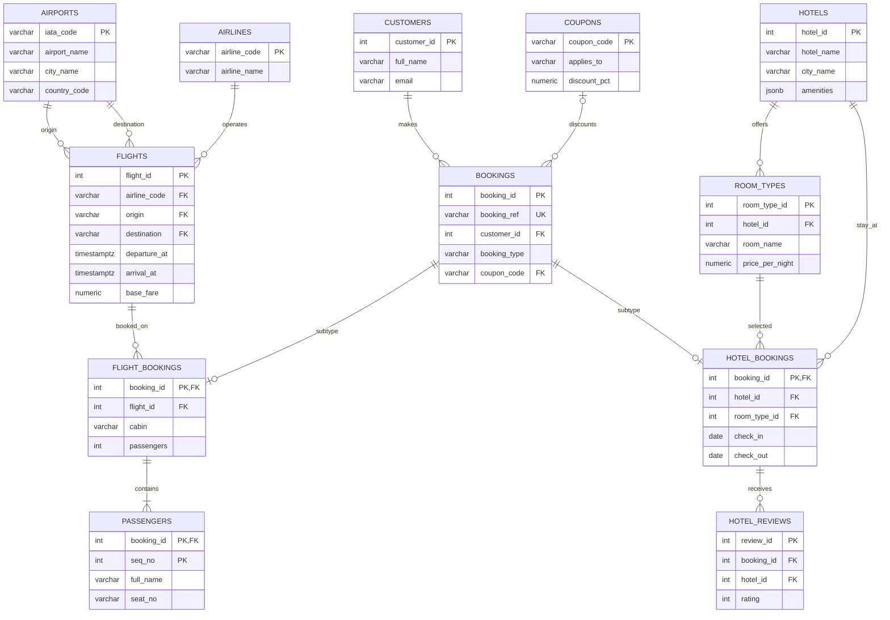

# Phase 2 — Schema Design, Constraints & Normalization

**Project:** MakeMyTrip Travel Booking Database  
**DBMS:** PostgreSQL 15+  
**Schema:** `mmt`

> Important: the source specification describes the 12 CSV files and their headers. This document records the design inferred from those headers and the business rules. Execute the load and validation scripts on the supplied `seed_data/` before marking the results as passed. Do not report expected row counts as actual results until PostgreSQL confirms them.

## 1. Design overview

The database separates reference/master data (airports, airlines, hotels, room types, customers and coupons) from transactional data (bookings and their flight/hotel subtypes), and from child data (passengers and reviews).

### Tables and primary keys

| Table | Primary key | Purpose |
|---|---|---|
| `airports` | `iata_code` | Airport master data |
| `airlines` | `airline_code` | Airline master data |
| `flights` | `flight_id` | One dated flight instance |
| `hotels` | `hotel_id` | Hotel master data and amenities |
| `room_types` | `room_type_id` | Room category offered by a hotel |
| `customers` | `customer_id` | Customer/account information |
| `coupons` | `coupon_code` | Coupon rules and validity |
| `bookings` | `booking_id` | Common booking, customer, payment and cancellation information |
| `flight_bookings` | `booking_id` | Flight-specific booking details; 1:1 with `bookings` |
| `passengers` | (`booking_id`, `seq_no`) | One passenger per sequence within a flight booking |
| `hotel_bookings` | `booking_id` | Hotel-specific stay details; 1:1 with `bookings` |
| `hotel_reviews` | `review_id` | Review for a hotel stay |

## 2. Data dictionary

The SQL file is the executable source of truth for exact types and constraints. This summary explains the design choices.

| Table | Column | PostgreSQL type | Constraint / reason |
|---|---|---|---|
| airports | iata_code | VARCHAR(3) | PK; three uppercase letters |
| airports | airport_name, city_name | VARCHAR | NOT NULL descriptive attributes |
| airports | country_code | VARCHAR(2) | NOT NULL; two-letter code |
| airlines | airline_code | VARCHAR(3) | PK; short airline code |
| airlines | airline_name | VARCHAR(120) | NOT NULL |
| flights | flight_id | INTEGER | PK |
| flights | airline_code | VARCHAR(3) | FK → airlines |
| flights | flight_no | VARCHAR(12) | NOT NULL; code format check |
| flights | origin, destination | VARCHAR(3) | FKs → airports; must differ |
| flights | departure_at, arrival_at | TIMESTAMPTZ | Time-zone-aware; arrival after departure |
| flights | aircraft, status | VARCHAR | Aircraft may be NULL; status required |
| flights | total_seats | SMALLINT | Positive seat capacity |
| flights | base_fare | NUMERIC(10,2) | Non-negative currency amount |
| hotels | hotel_id | INTEGER | PK |
| hotels | hotel_name, city_name | VARCHAR | NOT NULL |
| hotels | star_rating | SMALLINT | Nullable rating from 1 to 5 |
| hotels | user_rating | NUMERIC(2,1) | Nullable rating from 0 to 5 |
| hotels | amenities | JSONB | Non-null JSON object of amenity flags |
| hotels | check_in_time, check_out_time | TIME | Local hotel times |
| room_types | room_type_id | INTEGER | PK |
| room_types | hotel_id | INTEGER | FK → hotels |
| room_types | room_name | VARCHAR(100) | NOT NULL |
| room_types | max_guests, total_rooms | SMALLINT | Positive capacities |
| room_types | price_per_night | NUMERIC(10,2) | Non-negative amount |
| customers | customer_id | INTEGER | PK |
| customers | full_name, email | VARCHAR | Required; email format checked |
| customers | phone | VARCHAR(20) | Nullable; source may omit it |
| customers | loyalty_tier | VARCHAR(20) | Required; kept open to source tiers |
| customers | created_at | TIMESTAMPTZ | Time-zone-aware creation time |
| coupons | coupon_code | VARCHAR(30) | PK |
| coupons | applies_to | VARCHAR(10) | FLIGHT / HOTEL / ALL |
| coupons | discount_pct | NUMERIC(5,2) | Greater than 0 and at most 100 |
| coupons | max_discount | NUMERIC(10,2) | Non-negative amount |
| coupons | valid_from, valid_to | DATE | End date cannot precede start date |
| bookings | booking_id | INTEGER | PK |
| bookings | booking_ref | VARCHAR(20) | NOT NULL, UNIQUE business reference |
| bookings | customer_id | INTEGER | FK → customers |
| bookings | booking_type | VARCHAR(10) | FLIGHT or HOTEL |
| bookings | booked_at | TIMESTAMPTZ | Time-zone-aware booking time |
| bookings | total_amount, discount | NUMERIC | Non-negative; discount cannot exceed total |
| bookings | coupon_code | VARCHAR(30) | Nullable FK → coupons |
| bookings | payment_method, status | VARCHAR | Required source-defined labels |
| bookings | cancelled_at | TIMESTAMPTZ | NULL when not cancelled |
| bookings | refund_amount | NUMERIC(12,2) | Nullable; constrained against cancellation and paid amount |
| flight_bookings | booking_id | INTEGER | PK and FK → bookings; 1:1 subtype |
| flight_bookings | flight_id | INTEGER | FK → flights |
| flight_bookings | cabin | VARCHAR(20) | Required source label |
| flight_bookings | passengers | SMALLINT | Positive count; retained for workload compatibility |
| flight_bookings | fare_paid | NUMERIC(12,2) | Non-negative; retained as transaction snapshot |
| passengers | booking_id | INTEGER | Part of composite PK; FK → flight_bookings |
| passengers | seq_no | SMALLINT | Part of composite PK; positive sequence |
| passengers | full_name | VARCHAR(150) | Required |
| passengers | age | SMALLINT | Nullable; 0–120 when present |
| passengers | gender | VARCHAR(10) | Nullable; source labels preserved |
| passengers | seat_no | VARCHAR(8) | Nullable until seat assignment |
| hotel_bookings | booking_id | INTEGER | PK and FK → bookings |
| hotel_bookings | hotel_id | INTEGER | FK → hotels |
| hotel_bookings | room_type_id | INTEGER | Composite FK with hotel_id ensures room type belongs to hotel |
| hotel_bookings | check_in, check_out | DATE | Check-out after check-in |
| hotel_bookings | rooms, guests | SMALLINT | Positive counts |
| hotel_bookings | room_number | VARCHAR(20) | Nullable until check-in/room assignment |
| hotel_reviews | review_id | INTEGER | PK |
| hotel_reviews | booking_id, hotel_id | INTEGER | Composite FK → matching hotel booking |
| hotel_reviews | rating | SMALLINT | Integer from 1 to 5 |
| hotel_reviews | title | VARCHAR(200) | Required |
| hotel_reviews | review_text | TEXT | Nullable; a review may have no body |
| hotel_reviews | created_at | TIMESTAMPTZ | Required timestamp |

## 3. Relationships and cardinalities

- One airline has many dated flights (1:N).
- One airport can be the origin of many flights and the destination of many flights (two 1:N relationships).
- One hotel has many room types (1:N).
- One customer can make many bookings (1:N).
- One coupon can be applied to many bookings; a booking uses zero or one coupon (1:N, optional on booking).
- Each booking has exactly one subtype in the business model: flight OR hotel. The subtype tables use `booking_id` as both PK and FK, enforcing at most one subtype row per booking. The cross-table “exactly one and matches booking_type” rule is checked by the validation query after load.
- One flight can be referenced by many flight bookings (1:N).
- One flight booking has one or more passenger rows (1:N).
- One hotel booking can have a review; the schema allows multiple review rows unless application rules enforce one review per stay.
- Each hotel review references the exact `(booking_id, hotel_id)` pair in `hotel_bookings`, preventing a review from naming a different hotel than the stay.

### Mermaid ER diagram

## 4. Functional dependencies and normal forms

For each relation, the listed determinant is a candidate key (or declared unique key) and determines the remaining attributes. These dependencies assume the business meaning represented by the CSV headers.

| Relation | Main functional dependency | Normal form |
|---|---|---|
| airports | `iata_code → airport_name, city_name, country_code` | BCNF |
| airlines | `airline_code → airline_name` | BCNF |
| flights | `flight_id → airline_code, flight_no, origin, destination, departure_at, arrival_at, aircraft, total_seats, base_fare, status` | BCNF |
| hotels | `hotel_id → hotel_name, city_name, star_rating, user_rating, amenities, check_in_time, check_out_time` | BCNF |
| room_types | `room_type_id → hotel_id, room_name, max_guests, price_per_night, total_rooms` | BCNF |
| customers | `customer_id → full_name, email, phone, loyalty_tier, created_at` | BCNF |
| coupons | `coupon_code → applies_to, discount_pct, max_discount, valid_from, valid_to` | BCNF |
| bookings | `booking_id → booking_ref, customer_id, booking_type, booked_at, total_amount, coupon_code, discount, payment_method, status, cancelled_at, refund_amount`; also `booking_ref → other attributes` | BCNF |
| flight_bookings | `booking_id → flight_id, cabin, passengers, fare_paid` | BCNF |
| passengers | `(booking_id, seq_no) → full_name, age, gender, seat_no` | BCNF |
| hotel_bookings | `booking_id → hotel_id, room_type_id, check_in, check_out, rooms, guests, room_number` | BCNF |
| hotel_reviews | `review_id → booking_id, hotel_id, rating, title, review_text, created_at` | BCNF |

### Why the design reaches 3NF/BCNF

1. Every field is represented as a single value in its relational column. Passenger rows are separate; hotel amenities are a JSON object because the provided workload filters JSON amenity keys. They are not a comma-separated list.
2. Every non-key attribute in each relation depends on the whole candidate key. `passengers` uses the composite key `(booking_id, seq_no)` and passenger attributes depend on that complete key.
3. Master data is separated from transactions. Airline names are not repeated in every flight; airport names are not repeated in flight rows; room type descriptions are not repeated in every stay.
4. The subtype tables keep flight-only and hotel-only attributes out of the common `bookings` row.

## 5. Redundant / derived attributes and retention decisions

| Attribute | Potential redundancy | Decision |
|---|---|---|
| `flight_bookings.passengers` | Passenger count can be derived with `COUNT(*)` from `passengers`. | Retain because the supplied workload/data export uses it and it can support quick operational reads. Validate equality against passenger rows after load. It is a controlled denormalization and can drift unless writes are transactional. |
| `flight_bookings.fare_paid` | May be related to `bookings.total_amount`, discount and other booking components. | Retain as the flight-specific fare snapshot. Do not assume it equals `total_amount - discount` without confirming whether totals include fees/taxes or other components. |
| `hotel_reviews.hotel_id` | Can be derived by joining `hotel_bookings` using `booking_id`. | Retain for workload compatibility, but enforce consistency with composite FK `(booking_id, hotel_id)`. |
| `hotels.amenities` | Multiple amenity attributes are embedded in one JSON object. | Keep as JSONB because the source provides JSON-shaped data and amenity filtering is part of the given workload. If amenities become independently managed or need rich metadata, normalize to `amenities` and `hotel_amenities` tables in a future redesign; do not change the required CSV schema/workload in this phase. |

## 6. NULL handling

- `bookings.coupon_code`: NULL when no coupon was applied.
- `bookings.cancelled_at`: NULL when the booking has not been cancelled.
- `bookings.refund_amount`: NULL when no cancellation/refund has been processed.
- `passengers.seat_no`: NULL before seat assignment at web check-in.
- `hotel_bookings.room_number`: NULL before the front desk assigns a room.
- `hotels.user_rating`: nullable if no rating is available.
- `customers.phone`: nullable when not supplied.
- `passengers.age` and `gender`: nullable if not supplied.
- `hotel_reviews.review_text`: nullable when a review has a title/rating but no written body.
- `hotels.star_rating`: nullable if the source does not specify a category.

## 7. Constraints implemented

The schema includes primary keys, foreign keys, unique booking reference, NOT NULL rules and more than 12 CHECK constraints, including:

- IATA and country-code formats.
- Airline code and flight-number formats.
- Origin and destination must differ.
- Arrival must be after departure.
- Positive seat capacity and non-negative fares.
- Hotel ratings within their allowed numeric ranges.
- Amenities must be a JSON object.
- Positive room capacity, room count and guest count.
- Email shape and non-empty names/identifiers.
- Coupon applicability, percentage and validity dates.
- Booking type, non-negative amounts and discount not greater than total.
- Coupon absence implies zero discount.
- Cancellation/refund consistency and refund not greater than booking total.
- Positive passenger count and passenger sequence.
- Stay check-out after check-in.
- Review rating between 1 and 5.

The schema intentionally avoids hard-coding undocumented status, payment-method, cabin, loyalty-tier or gender enumerations. The seed data and workload must be used to confirm their complete value domains before tightening them.

## 8. Referential actions

- `ON DELETE RESTRICT` for master data referenced by transactions, preventing accidental deletion of airports, airlines, flights, hotels, room types, customers or coupons in use.
- `ON DELETE SET NULL` for a coupon reference if a coupon is removed; booking history remains.
- `ON DELETE CASCADE` from a booking to its subtype and passenger/review detail rows, preserving subtype lifecycle if a booking is intentionally deleted. In production, financial booking records are normally retained/soft-deleted; this action is chosen for controlled project data cleanup.
- `ON UPDATE CASCADE` for referenced identifiers.

## 9. Load and validation procedure

1. Extract `seed_data.zip` into `seed_data/` at the repository root.
2. Run `psql -d <database> -f sql/01_schema.sql`.
3. Run `psql -d <database> -f sql/02_load_data.sql` from the repository root. `\copy` reads local CSV files using paths relative to the psql working directory.
4. Check the row-count output against the expected values below.
5. Save actual output from all integrity checks in this section before submission.

### Expected row counts from the project brief

| CSV / table | Expected rows |
|---|---:|
| airports | 16 |
| airlines | 5 |
| flights | 13,848 |
| hotels | 3,000 |
| room_types | 9,000 |
| customers | 40,000 |
| coupons | 30 |
| bookings | 144,792 |
| flight_bookings | 84,899 |
| passengers | 163,380 |
| hotel_bookings | 59,893 |
| hotel_reviews | 15,913 |

**Actual result:** Not yet executed in this generated deliverable. Paste the PostgreSQL output here after running the load script; do not label expected values as measured actual values.

### Integrity checks and expected interpretation

| Check | Query is in `sql/02_load_data.sql` | Passing result |
|---|---|---|
| Booking subtype completeness/exclusivity | `invalid_booking_subtypes` | 0 |
| Passenger count vs passenger rows | `passenger_count_mismatches` | 0 rows |
| Flight subtype parent type | `invalid_flight_booking_types` | 0 |
| Hotel subtype parent type | `invalid_hotel_booking_types` | 0 |
| Coupon applicability and validity date | `coupon_rule_violations` | 0 |
| Booking timestamp before flight departure | `bookings_after_departure` | 0 |

If any check is non-zero, inspect the offending rows before changing constraints. A mismatch may indicate source-data quality issues or a business rule that needs clarification.

## 10. PostgreSQL indexes at this phase

No manual indexes are created in Phase 2, as required. PostgreSQL automatically creates indexes for primary-key and unique constraints (including `bookings.booking_ref` and the declared composite unique keys). Query-specific B-tree, partial, expression, GIN or BRIN indexes belong in Phase 4's `sql/05_indexes.sql`.

## 11. Files in this phase

- `docs/01_problem_understanding.md`
- `docs/02_schema_design.md`
- `sql/01_schema.sql`
- `sql/02_load_data.sql`
- `diagrams/er_diagram.mmd`
- `diagrams/er_diagram.svg`
